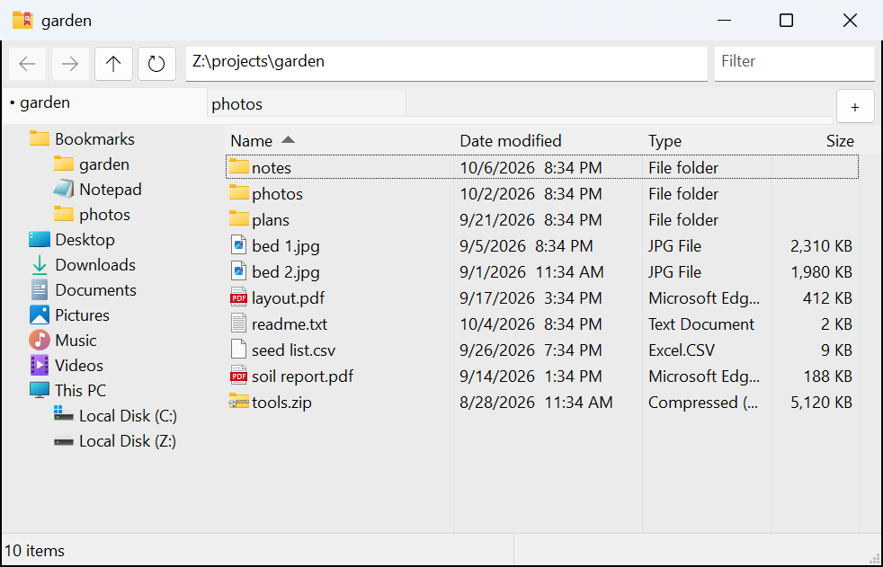

# Qoqdir

A small, fast file explorer for Windows 10/11 with tabs, a folder tree and a
detail list. It is meant to be started from Windows Terminal. One portable exe,
written in C++ and plain Win32 (there is a Rust version too): no runtime, no
installer, and no network code (no updates, no telemetry).



## Download

Get `qoqdir-<version>.zip` from the [Releases](../../releases) page and unzip it
into a folder you can write to: settings and Bookmarks are saved next to the exe,
so not in Program Files. Then run `qoqdir.exe`. It needs Windows 10 or 11, x64.

Beside it, `qoqdir-rust-<version>.zip` holds the same program written in Rust:
the same window, keys and files, passing the same tests. Either one will do.

The exe isn't signed, so the first start may show "Windows protected your PC":
choose More info, then Run anyway. Each release lists the SHA-256 of both zips,
which `Get-FileHash` on the zip you got should match.

## Command line

```
qoqdir [options] [folder ...]

  {folder}           open the folder in a tab (qoqdir . works too)
  {file}             open its folder, with the file selected
  --tab="{folder}"   the same: --tab="D:\logs"
  -t="{folder}"      short for --tab=: -t="D:\logs" -t="C:\My Files"
  -h, --help, -?     print the help: options, examples, notes for scripts
```

Each folder opens once, and the first one is shown. With no folders you get the
home folder. `D:` means `D:\`. A file opens its folder with the file selected,
as `explorer /select,` does. A folder that can't be opened yet, like a network
drive that isn't connected, still gets its tab. All after `-t=` or `--tab=` is
the folder, even a name that starts with `-`. Quote the folder after `-t=`:
PowerShell reads an unquoted `-t=` as a switch of its own and splits
`-t=my.folder` at the dot. `--tab=` works unquoted in cmd, PowerShell and Git
Bash (Git Bash leaves `~` as it is, so write `"$HOME"`). Don't end a quoted
folder with `\`: cmd and Windows PowerShell 5.1 read `\"` as a quote. Put
`qoqdir.exe` in a folder on your PATH to type just `qoqdir`.

## Getting around

The tree on the left starts with Bookmarks, then your Desktop, Downloads,
Documents, Pictures, Music and Videos, then This PC with the drives (This PC
shows each drive's free space in the Type column). Click a folder to open it in
the current tab, middle-click it for a new background tab, or right-click it for
Windows' own menu.

The address bar (Ctrl+L) takes more than a path:

- A folder path opens here. `D:` means `D:\`, `%USERPROFILE%` and forward
  slashes work, and so do `..` and the name of a subfolder of the current folder.
- A file path opens the file as a double-click would; the tab stays where it is.
- Anything else runs as a command, the way the Run box (Win+R) runs it, in the
  current folder: `cmd` opens a terminal there, `notepad notes.txt` opens that
  file, a web address opens the browser. `%VARIABLES%` are expanded. A program
  named without a folder (`cmd`, `code`) is the one on your PATH, never a file
  of that name in the current folder.

A path that doesn't work stays selected in the box so it can be fixed, and Esc
puts the current path back.

To filter the list, just start typing: the text goes into the filter box, and
the list shows the names that contain it, ignoring case. With `*` or `?` it is
a pattern, and `;` separates several: `*.jpg; *.png`. Esc shows all again.
Going to another folder clears the filter; refreshing keeps it.

Folders come before files, numbers in names sort naturally (`file2` before
`file10`), and a click on a column header sorts by it. Opening a shortcut
(`.lnk`) to a folder opens that folder in the tab; other shortcuts, `.url` links
and files are opened by Windows.

## Bookmarks

Keep shortcuts to the folders you use often in the `Bookmarks` folder next to
`qoqdir.exe`. It is created if missing and shown at the top of the tree.
Right-click a tab and choose Bookmark this folder, Alt+drag a folder into it,
or copy a folder and use Paste shortcut there. Rename or delete bookmarks like
any file. Subfolders group them, and open in the tree too. On a flash drive
they keep working when the drive gets another letter: a shortcut made on the
same drive also remembers the way from itself to its target.

Tabs aren't saved by themselves. Ctrl+S (or "Save tabs" on a tab's right-click
menu) saves them as shortcuts in `Bookmarks\Tabs`, replacing the ones there, and
Ctrl+O ("Open saved tabs") opens them again after your open tabs. To keep a set,
rename that folder. Closing a window with four or more tabs open asks whether to
save them first.

## Keys

| Keys | Action |
|---|---|
| Ctrl+T / Ctrl+W | new tab / close tab |
| Ctrl+S / Ctrl+O | save the tabs / open the saved tabs |
| Ctrl+Tab, Ctrl+Shift+Tab, Ctrl+1 to 9 | switch tab |
| Ctrl+Shift+PgUp / PgDn | move the tab left / right |
| Ctrl+L, Alt+D, F4 | address bar |
| Ctrl+F, F3 | filter box (or just start typing in the list) |
| F5, Ctrl+R | refresh the list and the tree (or the Refresh button) |
| Ctrl+H | show or hide hidden files |
| Ctrl+` | a terminal in the folder (Windows Terminal, or cmd without it) |
| Alt+Left / Alt+Right / Alt+Up | back / forward / up |
| Tab, Shift+Tab | move between the address bar, filter, tree and list |
| Enter / Ctrl+Enter | open / open in a background tab |
| Backspace | up |
| Delete / Shift+Delete | recycle / delete for good |
| F2 | rename |
| Ctrl+Shift+N | new folder |
| Ctrl+A | select all |
| Ctrl+C / Ctrl+X / Ctrl+V | copy / cut / paste |
| Ctrl+Shift+C | copy as path (of the folder when nothing is selected) |
| Alt+Enter | properties (of the folder when nothing is selected) |
| Esc | clear the filter |
| Ctrl+Backspace | delete the word before the cursor (address bar, filter) |
| F1 | the main keys |

The mouse's back and forward buttons go back and forward. Middle-click a folder
to open it in a background tab, or double-click the empty part of the tab bar
for a new tab. New tabs always go at the end. Drag a tab along the bar to move
it, and turn the mouse wheel over the tabs to switch between them. A tab's
right-click menu also has Duplicate tab and Close other tabs. Drop files on the
list or on a folder in it, on a tab, or on a folder or bookmark in the tree to
copy or move them there. A plain drop that could move them asks first, with
Windows' own menu (Copy here, Move here, Create shortcuts here), so nothing
moves by accident; hold Ctrl to copy, Shift to move or Alt to make shortcuts
without the question. A closed folder in the tree opens when you hold the drag
over it. (The tree takes drops on local drives only.)

Right-click on files gives Windows' full context menu, so Send to, Open with and
the entries of other programs are all there. Right-click the empty space for
Open in new window, which opens the folder in a second Qoqdir window. For what
Qoqdir doesn't do, thumbnails and searching inside subfolders, the same menu has
Open in Explorer and Search in Explorer, which open that folder there.

Qoqdir has no undo of its own: Windows keeps one undo list for all programs. To
take back a rename, move, copy or delete done in Qoqdir, click the desktop (or an
Explorer window) and press Ctrl+Z. A Shift+Delete can't be undone.

## Files it writes

Next to `qoqdir.exe`: `qoqdir.ini` (window size, tree and column widths, sort
order, hidden files on or off; never tabs or paths) and the `Bookmarks` folder.
Nothing goes in the registry or AppData. The only other file is
`%TEMP%\qoqdir-crash.log`, written if the program stops on a bug or hangs.

## Bugs

If Qoqdir stops on a bug, the last line of `%TEMP%\qoqdir-crash.log` says what
happened. A window that answers nothing for 5 seconds gets a line there too,
saying where it was stuck (often inside a shell extension of another program),
and then goes on. Please open an issue with that line (it holds the Qoqdir
version) and your Windows version.

## Build

Windows 10 or 11, x64. One download holds the compiler and the build tools.
Nothing gets installed, and no admin rights are needed.

1. Get the compiler: MinGW-w64 GCC 13.2 from winlibs, with CMake and Ninja
   inside. The file is
   `winlibs-x86_64-posix-seh-gcc-13.2.0-mingw-w64ucrt-11.0.1-r8.zip` (216 MB,
   or the `.7z` at 94 MB), from
   https://github.com/brechtsanders/winlibs_mingw/releases/tag/13.2.0posix-18.1.5-11.0.1-ucrt-r8.
   On https://winlibs.com/ it is the Win64 link "without LLVM/Clang/LLD/LLDB"
   under GCC 13.2.0, UCRT, release 8.
2. Unpack it. The archive holds one folder, `mingw64`. Put that folder in
   `%LOCALAPPDATA%\Programs`, so that
   `%LOCALAPPDATA%\Programs\mingw64\bin\g++.exe` exists.
3. Build. In PowerShell, in this folder:

```powershell
$env:PATH = "$env:LOCALAPPDATA\Programs\mingw64\bin;" + $env:PATH
cmake -S . -B build -G Ninja
cmake --build build
```

The result is `build\qoqdir.exe`, one statically linked file. To remove the
compiler later, delete its folder.

Without CMake and Ninja, `windres` and `g++` alone build it; both come with any
MinGW-w64 GCC. Instead of the two `cmake` lines:

```powershell
$mingw = (Split-Path (Split-Path (Get-Command g++).Source)) -replace '\\', '/'
windres res\qoqdir.rc -O coff -o qoqdir-res.o
g++ -std=c++20 -O2 -DNDEBUG -DUNICODE -D_UNICODE -DNOMINMAX -D_WIN32_WINNT=0x0A00 -DWINVER=0x0A00 -D_GLIBCXX_ASSERTIONS -fsanitize=signed-integer-overflow -fsanitize-undefined-trap-on-error "-ffile-prefix-map=$mingw=mingw64" -ffunction-sections -fdata-sections -mwindows -municode -static '-Wl,--gc-sections' -s src\main.cpp src\app.cpp src\filelist.cpp src\tree.cpp src\shell.cpp src\folder.cpp src\crashlog.cpp qoqdir-res.o -o qoqdir.exe -lole32 -loleaut32 -lshell32 -lshlwapi -lcomctl32 -luuid
```

This leaves `qoqdir.exe` in this folder, the same program the CMake build
makes, in under a minute. The first line is for the exe's runtime checks: their
messages name the compiler's header files, and `-ffile-prefix-map` makes them
say `mingw64/...` instead of a full path that may hold your user name.

Notes. `%LOCALAPPDATA%` is `C:\Users\<you>\AppData\Local`. The compiler can go
in any folder whose path has no spaces, such as `C:\mingw64`; then write that
folder's `bin` in the PATH line instead. `docs/BUILDING.md` has the tests,
`scripts\build.ps1`, which builds and checks both versions, and the release
steps. GitHub Actions builds and checks both versions on every push
(`.github/workflows/build.yml`).

### The Rust version

`rust\` holds the same program in Rust. It needs Rust 1.91 or newer for the
GNU target, plus the MinGW `bin` above on the PATH for `windres`, which builds
the exe's manifest, icon and version block. This installs
Rust in `%LOCALAPPDATA%\Programs\rust`, again without admin rights. In
PowerShell:

```powershell
$R = "$env:LOCALAPPDATA\Programs\rust"; New-Item -ItemType Directory -Force $R
Invoke-WebRequest https://static.rust-lang.org/rustup/dist/x86_64-pc-windows-gnu/rustup-init.exe -OutFile $R\rustup-init.exe
$env:RUSTUP_HOME = "$R\rustup"; $env:CARGO_HOME = "$R\cargo"
& $R\rustup-init.exe -y --no-modify-path --profile minimal -c clippy --default-host x86_64-pc-windows-gnu --default-toolchain stable
```

Then put `%LOCALAPPDATA%\Programs\rust\cargo\bin` on the PATH too, and run
`cargo build --release` in `rust\`. The result is
`rust\target\release\qoqdir.exe`. `docs/BUILDING.md` section 1 has a short
script that sets Rust's PATH in each new terminal.

## Source

- `src/` the program, `res/` its manifest and icon
- `rust/` the same program in Rust
- `tests/` the unit tests and the check scripts (the exe, the command line, the
  self-test with its popup watch, and the comparison of the two self-test logs)
- `scripts/` `build.ps1` builds and checks both versions, `release.ps1` makes a
  release of both (both scripts find the tools through `find-tools.ps1`),
  `make-icon.ps1` draws the icon
- `docs/` `BUILDING.md` (tools, building, testing, releases), `DEVELOPING.md`
  (notes for working on the code) and `SPEC.md` (what Qoqdir must do and
  how it must behave)

## License

MIT, see `LICENSE`. Each exe also contains parts of MinGW-w64's runtime, and the
Rust one also Rust's standard library and Microsoft's windows crates. Their
licenses are in each zip's `THIRD-PARTY-NOTICES.txt` (here, in the top folder
and in `rust/`).
